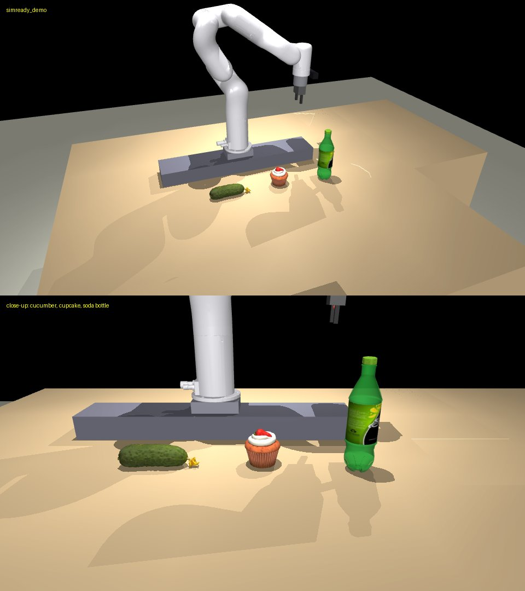

# simready_demo

The empty bench (`_templates/empty_bench`) with three NVIDIA SimReady assets
placed by `simready_import`: a cucumber, a cupcake and a green soda bottle
(`nvidia/simready-assets` at `a666cb43`, CC-BY-4.0; see
`assets/simready/ATTRIBUTION.md`). Built with:

```bash
python -m twin_rooms new simready_demo --name "SimReady demo bench"
python -m simready_import fetch --picks
python -m simready_import place cucumber_a01      --room simready_demo --name cucumber --pos -0.10 -0.25 --euler 0 0 90 --label cucumber
python -m simready_import place cupcake_g01       --room simready_demo --name cupcake  --pos  0.12 -0.25 --label cupcake
python -m simready_import place bottled_drink_e01 --room simready_demo --name bottle   --pos  0.32 -0.28 --label "green soda bottle"
```

Run it: `python scripts/run_task.py "pick up the cucumber and put it down 150 mm to the right" --room simready_demo`.
The bottle is too tall for the twin's top-down grasp (see `simready_import/README.md`); push it.



First live run (Haiku, 2026-10-29): "pick up the cucumber and set it back down on the bench 120 mm away from where it is now, in the -y direction" -- grasped, carried, released; physical_outcome: cucumber moved (+1, -129) mm. (An earlier "+x 150 mm" target was refused mid-carry by the swept-path check: the cucumber would have hit the cupcake.)
